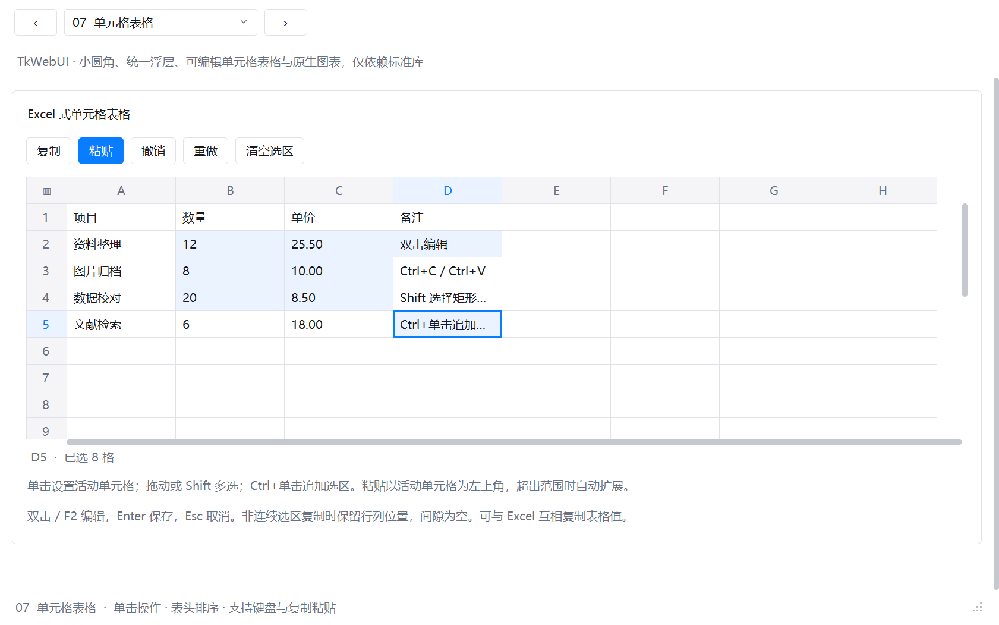
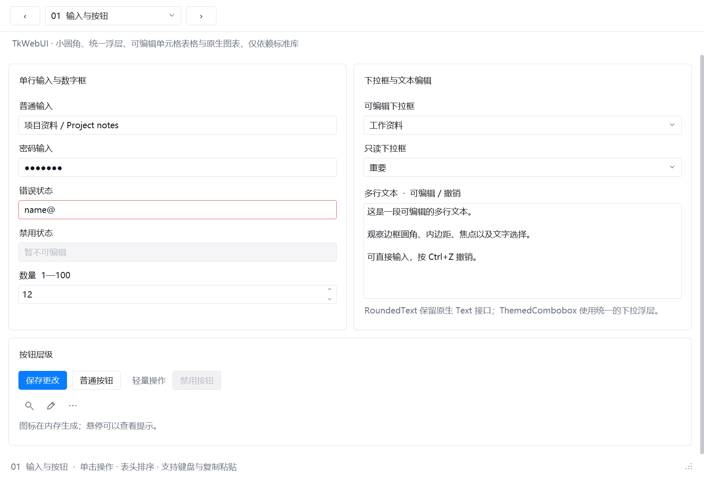
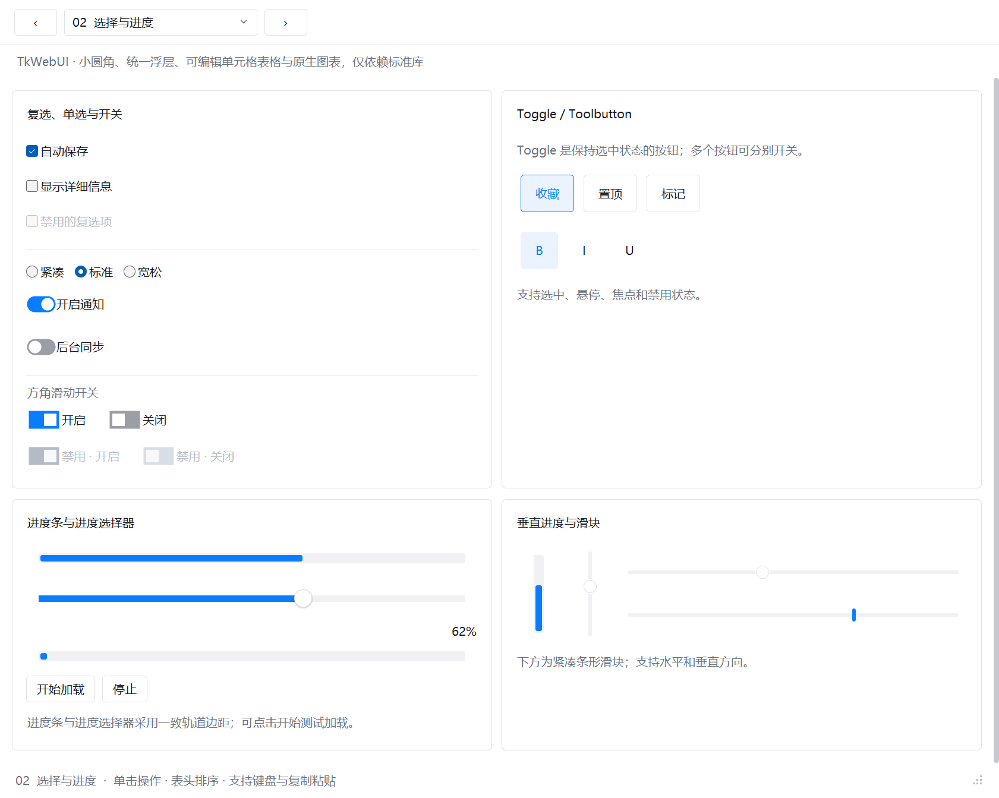
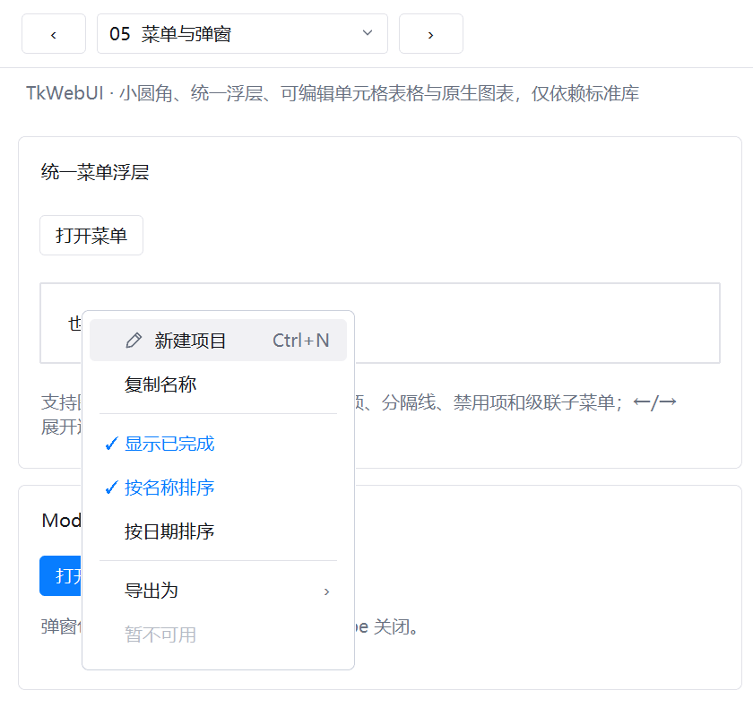
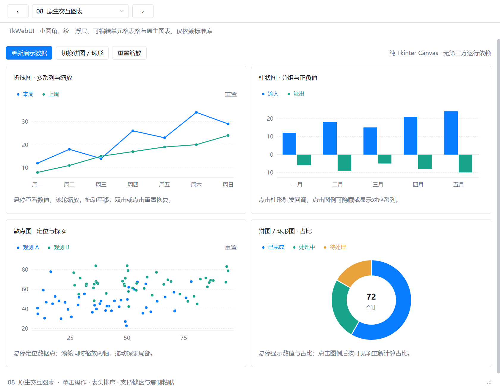
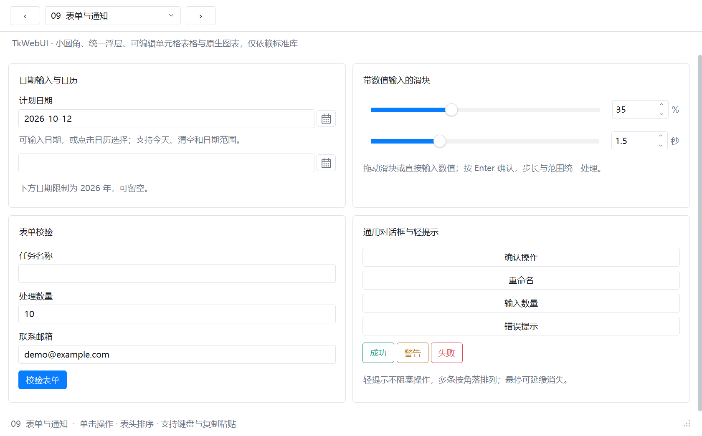
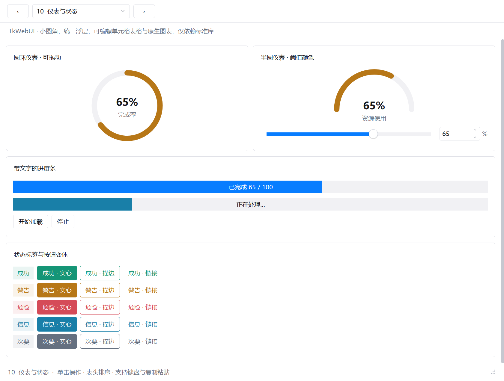
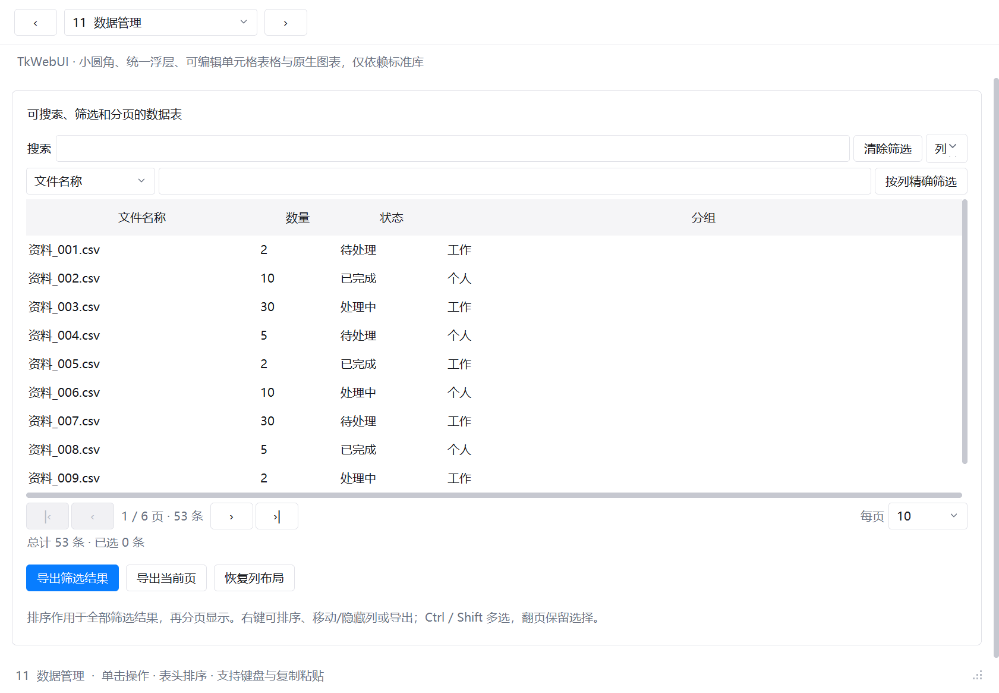
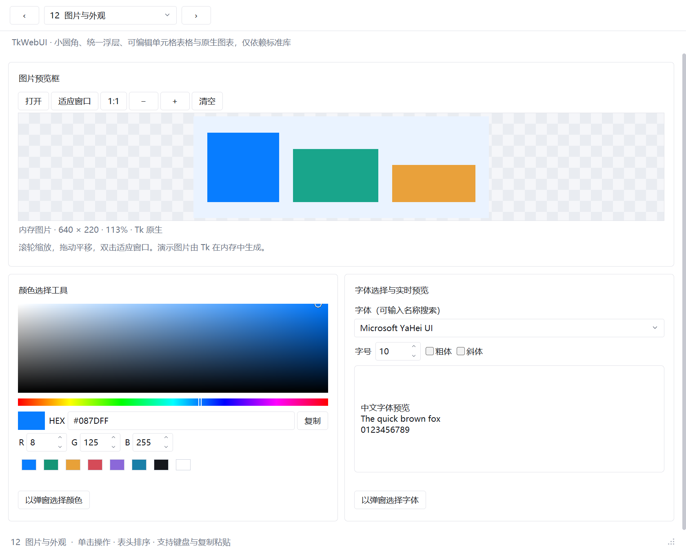
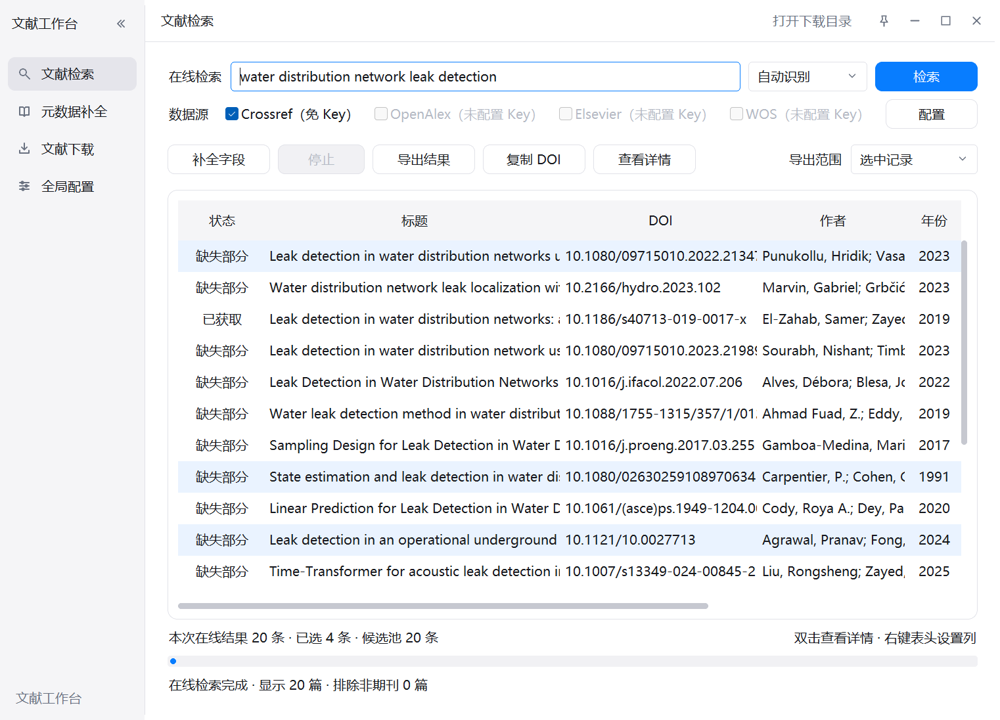

# TkWebUI · 现代 Web 风格的 Tkinter 主题与控件

给 Python 自带的 tkinter/ttk 换一身现代 Web 应用风格的外观，并补齐一批常用控件。

- **只用标准库**：不依赖 ttkbootstrap、customtkinter、Pillow、NumPy 或浏览器内核，打包时不额外引入第三方包。
- **不用图片素材**：圆角、图标、开关、仪表等图形都在内存中按 DPI 生成，没有外部 PNG 皮肤文件。
- **控件多**：覆盖常规 ttk 控件，并提供 Excel 式单元格表格、原生交互图表、日期选择、表单校验、轻提示、数据管理表格、颜色/字体选择等扩展组件。
- **旧代码好接入**：以 ttk 为主的旧工具，创建窗口后调用一次 `apply_theme(root)`，大部分界面就会换上新样式。
- **复制即用**：不走 pip，下载后把 `tkwebui` 文件夹放进自己的项目即可 import，想改哪里直接改源码。

> A modern, Web-style theme and widget set for Python's built-in tkinter/ttk. Standard library only,
> no image assets, includes an Excel-like spreadsheet with copy/paste and native interactive charts.
> Docs and demo are in Chinese.



## 如何选择：TkWebUI 还是 TkWin11

[TkWin11](https://github.com/bvb6417/tkwin11) 由 TkWebUI 分支而来，两者的控件大体相同，取舍不同：

| | TkWebUI | TkWin11 |
| --- | --- | --- |
| 外观 | 现代 Web 应用风格 | Windows 11 Fluent |
| 实现 | 样式一次生成后固定，不改动 Tk 的内部命令；代码量约为 TkWin11 的一半 | 运行时接管样式、图片、字体和控件命令，以支持动画、多显示器 DPI 和一键换肤 |
| 接入 | 创建窗口后调用 `apply_theme(root)`，换肤 ttk 控件 | 创建窗口前调用 `tkwin11.install()`，`tk.Button`、`tk.Menu` 等经典控件也一起换肤 |
| 动效 | 无过渡动画 | 悬停、按下、开关、导航和页面切换都有过渡 |
| 主题开销¹ | 启动约 +0.2 s，切页每页约 +16 ms | 启动约 +0.15 s，首次打开每页约 +70 ms |
| 平台 | 以 Windows 为主，其他平台使用纯 Python 回退（未测试） | 以 Windows 11 为目标，一体化标题栏和多显示器适配只在 Windows 生效 |

- **选 TkWebUI**：做科研、工程或内部工具，重点是单元格表格、数据表、图表、表单这类干活的组件；希望依赖少、行为可预期，出了问题能直接读懂源码。
- **选 TkWin11**：做发给 Windows 用户的桌面程序，或想让老 tkinter 程序一行代码换上 Windows 11 的观感；愿意为动效和多显示器适配多付一些开销。

¹ 同一窗口套用主题与不套用主题相比，Windows 11、150% 缩放下实测。两个库不要在同一个 Tk 解释器里混用。

## 快速开始

1. 在本页点击 **Code → Download ZIP** 并解压（或 `git clone`）。
2. 运行演示，看看所有控件（共 12 页）：

   ```bash
   python demo.py
   ```

   `python demo.py --page 7` 可以直接打开第 7 页（单元格表格）。

3. 把 `tkwebui` 文件夹复制到你的脚本旁边，然后：

   ```python
   import tkinter as tk
   from tkinter import ttk
   from tkwebui import enable_dpi_awareness, apply_theme, Spreadsheet, LineChart

   enable_dpi_awareness()      # 在创建 Tk() 之前调用，高分屏下不发虚
   root = tk.Tk()
   apply_theme(root)           # 在创建控件之前调用

   ttk.Button(root, text='保存', style='Primary.TButton').pack(padx=16, pady=8)
   Spreadsheet(root, data=[['项目', '数量'], ['资料整理', '12']], rows=12, columns=6).pack(fill='both', expand=True)
   LineChart(root, values=[12, 18, 14, 26, 23], labels=['一', '二', '三', '四', '五']).pack(fill='both', expand=True)
   root.mainloop()
   ```

更多例子见 [examples/](examples/)。

## 组件一览

| 类别 | 组件 |
| --- | --- |
| 原生 ttk 控件（自动套用样式） | Button、Entry、Spinbox、Checkbutton、Radiobutton、LabelFrame、Notebook、Panedwindow、Treeview、Progressbar、Scale、Scrollbar、Separator、Sizegrip |
| 按钮与选择 | 主按钮 / 轻量按钮 / 语义色按钮（实心、描边、链接）、ToggleButton、ToolButton、圆形开关、SquareSwitch、SegmentedControl、Dropdown |
| 输入 | RoundedText、ThemedCombobox、DateEntry（带日历）、ValidatedEntry（表单校验）、PlaceholderEntry / set_placeholder（输入提示灰字）、ValueSlider、ProgressSlider |
| 菜单与弹窗 | ThemedMenu（图标、快捷键文字、勾选/单选、级联子菜单、键盘操作）、MenuButton、OptionMenu、Modal、Dialogs、Tooltip、notify 轻提示 |
| 表格与列表 | SortableTreeview（表头点击排序、自然排序）、**Spreadsheet（Excel 式单元格表格）**、DataTable（搜索、筛选、分页、列管理、CSV 导出）、RoundedListbox |
| 图表 | LineChart、ColumnChart、ScatterChart、DonutChart、PieChart：悬停提示、图例开关、点击回调、滚轮缩放与拖动平移 |
| 状态与反馈 | Meter（圆环 / 半圆仪表）、TextProgress（带文字进度条）、Badge |
| 布局与外观 | Card、SectionCard、Sidebar、Accordion、SettingRow、CardList、ScrollArea、ImageViewer、ColorPicker、FontPicker、WindowChrome（一体化窗口操作栏） |

### Excel 式单元格表格

`Spreadsheet` 是我做这个库最想要的功能之一：

- 单击定位，拖动 / Shift 选择矩形区域，Ctrl+点击追加不连续的单元格；
- Ctrl+C 复制为 TSV，可以直接粘贴进 Excel；在 Excel 里复制一块区域，也能 Ctrl+V 粘回来，空间不够时自动扩展；
- 双击 / F2 编辑，Enter、Tab 移动，Delete 清空，Ctrl+Z / Ctrl+Y 撤销重做；
- 只绘制可见区域，默认最多支持 100 万个单元格。

它只处理单元格的值，不读写 xlsx 文件，也不做公式计算和格式复制。

### 输入提示（灰字）

框内为空时显示浅灰色提示，开始输入后消失：

```python
ui.PlaceholderEntry(parent, placeholder='请输入用户名')
ui.set_placeholder(existing_entry, '搜索')       # 已有的 Entry / Combobox / Spinbox / tk.Entry
ui.set_placeholder(readonly_combo, '请选择…')    # 只读下拉框未选择时
```

提示是浮在输入框上的标签，不是框里的文字：`get()` 和 `textvariable` 始终是真实内容（为空就是空字符串），密码框、输入校验与只读状态不受影响；获得焦点后提示仍显示，直到开始输入。没有 `textvariable` 的输入框会自动绑定一个内部变量来感知内容变化。

## 截图

| | |
| --- | --- |
|  |  |
|  |  |
|  |  |
|  |  |

其余页面见 [docs/images](docs/images/)。

### 用它重做界面的程序

我的另一个开源工具 [文献工作台](https://github.com/bvb6417/literature-suite) 已经用这套主题重做了界面：



## 旧工具接入

如果你的旧工具主要用 `ttk` 控件，通常只需要在创建根窗口后、创建业务控件前加两行：

```python
from tkwebui import enable_dpi_awareness, apply_theme

enable_dpi_awareness()     # 原来创建 Tk() 之前
root = tk.Tk()
apply_theme(root)          # 原来创建控件之前
```

传统 `tk.Button`、`tk.Text`、`tk.Menu` 等不会被自动替换，需要换成对应的 ttk 控件或 TkWebUI 组件。详见 [docs/migration.md](docs/migration.md)。

## 文档

- [使用指南](docs/guide.md)：模块分工、最小接入、菜单、可排序列表、单元格表格
- [扩展组件](docs/components.md)：日期、表单校验、对话框、轻提示、仪表、数据表、图片、颜色与字体
- [原生图表](docs/charts.md)：折线、柱状、散点、饼图 / 环形图的数据格式和交互
- [旧工具接入](docs/migration.md)：已有 tkinter 程序如何迁移

## 环境与限制

- 开发和测试环境：Windows 11 + Python 3.11。代码语法兼容 Python 3.8+，但没有逐个版本测试。
- 主要面向 Windows：WindowChrome 一体化标题栏仅在 Windows 生效；抗锯齿绘制在 Windows 上调用系统自带的 GDI+，其他平台使用纯 Python 回退方案。macOS / Linux 目前没有测试。
- 目前只有浅色主题；主色可以通过 `apply_theme(root, accent='#RRGGBB', accent_hover='#RRGGBB')` 修改。
- 普通 `ttk.Combobox` 的下拉列表由系统绘制，样式无法统一，需要统一外观时请改用 `ThemedCombobox`。
- 图表定位是小工具里的常见图表（几十到几千个数据点），不是 Matplotlib 的替代品。

## 参与贡献

这个库是我按自己写小工具的需求做出来的，并不完善。欢迎：

- 提 [Issue](https://github.com/bvb6417/tkwebui/issues) 反馈 bug 或想要的控件；
- 提 Pull Request 补充新组件、修复问题或适配其他平台；
- 直接 fork 改成自己喜欢的样子。

## 致谢

本项目的主要代码由作者与 [OpenAI Codex](https://openai.com/codex/) 协作开发，开源整理、文档与测试由 [Claude Code](https://claude.com/claude-code) 协助完成。

## 许可证

[MIT](LICENSE)
